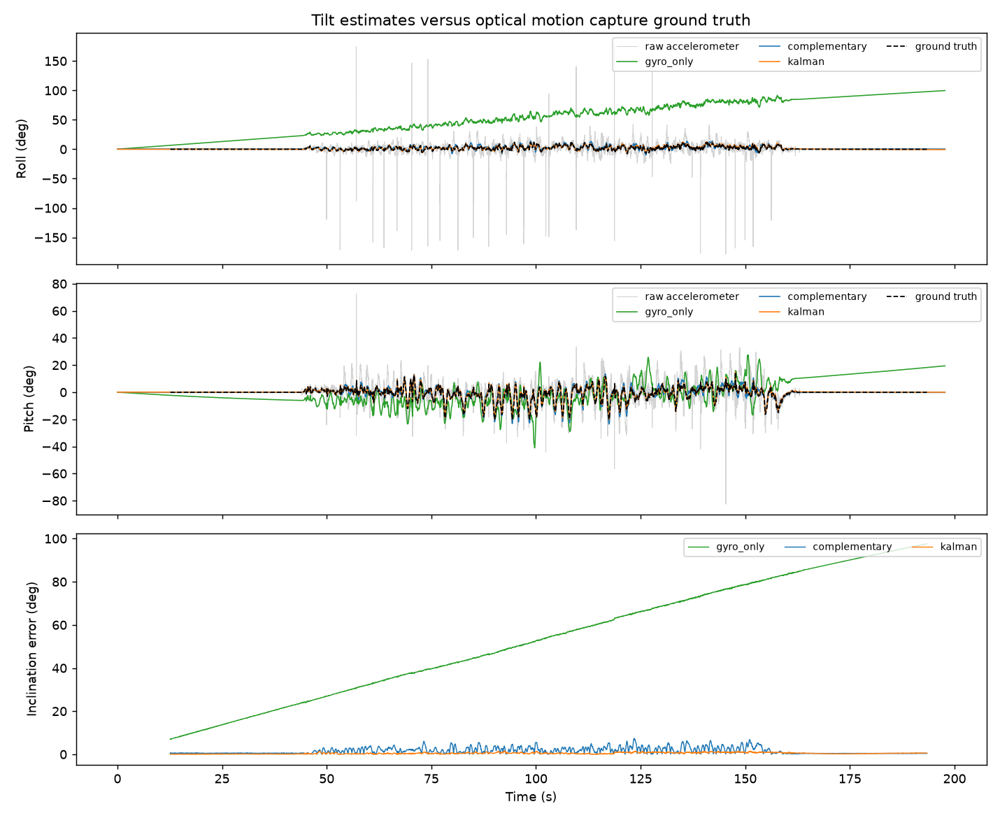
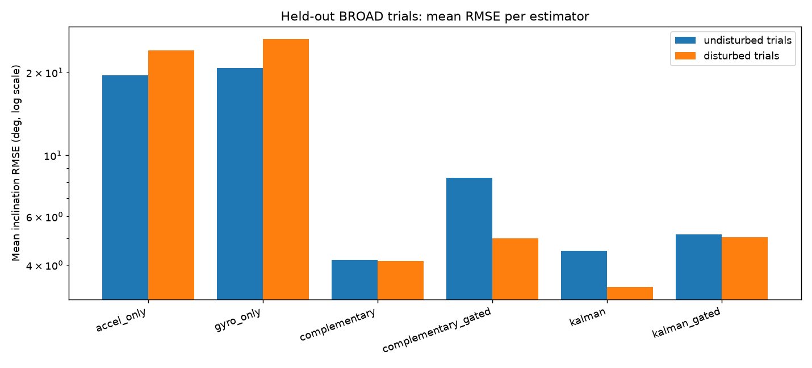
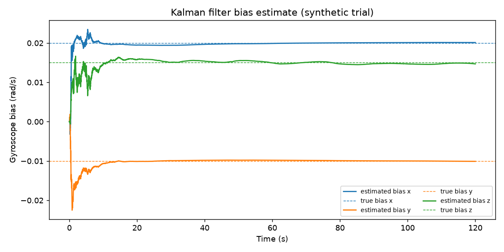

# imu-attitude-estimation

Tilt (roll and pitch) estimation from gyroscope and accelerometer data: four estimators benchmarked against optical motion capture on the BROAD dataset.




## What this is
A gyroscope gives smooth tilt that drifts; an accelerometer gives drift-free tilt that is corrupted whenever the sensor accelerates. I implemented four estimators of the gravity direction in the sensor frame (accelerometer only, gyroscope only, a complementary filter and an extended Kalman filter with gyroscope bias estimation) and compared them against optical motion capture ground truth.

## Results
Held-out BROAD trials (13 trials: 8 undisturbed, 5 disturbed), inclination error in degrees. I tuned parameters on 6 separate tuning trials, then ran the held-out set once. Full details in [docs/results.md](docs/results.md).

| estimator | undisturbed RMSE (deg) | disturbed RMSE (deg) | maximum error (deg) | trials |
|---|---|---|---|---|
| accel_only | 19.54 | 24.04 | 179.7 | 8 + 5 |
| gyro_only | 20.76 | 26.42 | 89.7 | 8 + 5 |
| complementary | 4.17 | 4.14 | 39.4 | 8 + 5 |
| complementary_gated | 8.28 | 5.00 | 92.4 | 8 + 5 |
| kalman | 4.51 | 3.33 | 31.1 | 8 + 5 |
| kalman_gated | 5.17 | 5.04 | 42.1 | 8 + 5 |



## How the filters work
Details and conventions in [docs/method.md](docs/method.md).

- **Accelerometer only**: `g = a / |a|`. No drift, but all linear acceleration shows up as tilt error.
- **Gyroscope only**: propagate `g <- g - dt * (omega x g)`, renormalise. Smooth, but any bias integrates into drift.
- **Complementary**: `g = normalise(alpha * propagate(g) + (1 - alpha) * a_unit)` with `alpha = tau / (tau + dt)`.
- **Kalman**: extended Kalman filter on `[g, b]` where `b` is the gyroscope bias; the accelerometer is the measurement of `g`.

## Accelerometer gate
A sample is flagged dynamic when `| |a| - 9.81 | > gate`; the complementary filter then ignores the accelerometer for that sample and the Kalman filter inflates its measurement noise. On these held-out trials it did not help: gated complementary is 8.28 / 5.00 deg (undisturbed / disturbed) versus 4.17 / 4.14 ungated, gated Kalman 5.17 / 5.04 versus 4.51 / 3.33.

## Kalman filter bias estimation


On a synthetic trial the filter's gyroscope bias estimate settles on the true bias within a few tens of seconds.

## Run it
```bash
pip install -r requirements.txt
pytest -q
# download BROAD as described in data/README.md, then:
python -m imufusion.eval.tune --trials trials_tuning.txt --split tuning
python -m imufusion.eval.run_benchmark --trials trials_heldout.txt --split heldout
python -m imufusion.plots.make_figures --undisturbed data/broad/01_undisturbed_slow_rotation_A.hdf5 --disturbed data/broad/25_disturbed_tapping_B.hdf5
```

## Project structure
```
imufusion/config   filter and gate settings, tuned defaults
imufusion/core     tilt maths, gate, gyro only, complementary, Kalman, estimator dispatch
imufusion/data     data types, synthetic generator, quaternion conversion, BROAD loader
imufusion/eval     inclination metric, benchmark CLI, tuning CLI
imufusion/plots    trial, summary and bias plots
imufusion/utils    logging
tests/             unit tests (no dataset needed)
docs/              method, results, environment notes
results/           metrics_heldout.json, metrics_tuning.json, tuning.json
```

## Limitations
Tilt only (no yaw, no magnetometer). Accelerometer-based correction fails under sustained acceleration, which dominates the fast BROAD trials. Parameters are tuned on one dataset (the Kalman optimum sits at the grid edge). Propagation is first order. There is no real-time embedded implementation.

## Data and licence
BROAD is CC BY 4.0: D. Laidig, M. Caruso, A. Cereatti, T. Seel, "BROAD - A Benchmark for Robust Inertial Orientation Estimation", Data 2021, 6(7), 72. The code is MIT licensed.
